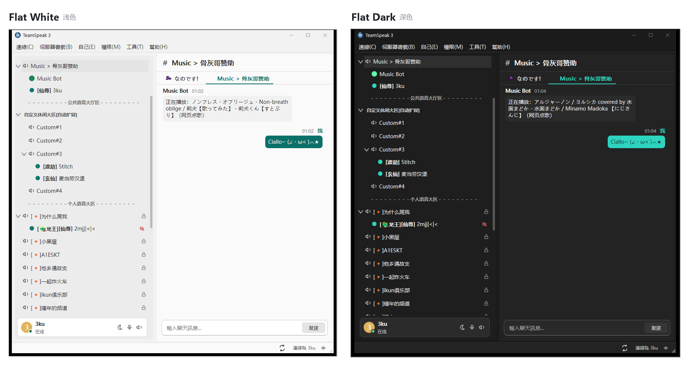

# Flat White · Flat Dark — TeamSpeak 3 Themes

[简体中文](README.md) | **English**

## Style

No gradients, no highlights, no shadows. Depth comes only from 1px hairlines, rounded
corners and a single teal accent. Controls use a 4px radius, panels 8px, body text is
14px, and everything is set in Microsoft YaHei UI so mixed Chinese and English keeps a
steady line height.

- **Flat White**: background `#F2F2F2`, panels `#FAFAFA`, text `#252525`, accent `#0B7068`.
- **Flat Dark**: background `#1B1B1B`, panels `#232323`, text `#F2F2F2`, accent `#2DD4BF`.
  With the plugin installed, the Windows title bar and window borders go dark too.

Each theme has its own line-icon set, and a companion plugin rearranges the client into a
content-first, Discord-style layout with bubble chat, message and poke notifications, a
floating user card and free window resizing.

## Download

Grab the archive you want from the
[latest release](https://github.com/mmk-1010/ts3-theme-flat-white/releases/latest):

- **Light**: [download Flat White](https://github.com/mmk-1010/ts3-theme-flat-white/releases/latest/download/Flat-White.zip)
- **Dark**: [download Flat Dark](https://github.com/mmk-1010/ts3-theme-flat-white/releases/latest/download/Flat-Dark.zip)

Both contain the theme, the icons and the plugin — it is the same plugin either way.
Sounds are optional and downloaded separately as
[Flat White Sounds](https://github.com/mmk-1010/ts3-theme-flat-white/releases/download/v1.6/Flat-White-Sounds.ts3_soundpack) or
[Flat Dark Sounds](https://github.com/mmk-1010/ts3-theme-flat-white/releases/download/v1.6/Flat-Dark-Sounds.ts3_soundpack); both hold the same sounds.

## Installation

Double-click each installer in order, restarting the client after every step:

1. **Theme**: double-click the `.ts3_style`, restart, then pick `flat_white` or `flat_dark`
   under **Tools → Options → Design → Theme**.
2. **Icons**: double-click the `.ts3_iconpack`, restart, then pick the matching pack under
   **Design → Icon Packs**.
3. **Plugin**: quit TS3 completely first, double-click the `.ts3_plugin`, then check it is
   ticked under **Tools → Options → Addons** after the next start.
4. **Sounds** (optional): double-click the downloaded `.ts3_soundpack`, restart, then pick it
   under **Tools → Options → Notifications → Sound Pack**.

Installing only the theme already reskins the client. Without the plugin the dark theme only
darkens the client area and the system still draws the title bar.

## Uninstall

Switch back to the defaults under **Options → Design** for the theme and icons; delete
`%APPDATA%\TS3Client\plugins\flatwhite_ui_win64.dll` for the plugin; delete the matching
folder under `sound\` in the client directory for the sounds.

## Compatibility

Tested on TeamSpeak 3 3.6.2 (Windows x64, Qt 5.15.2). The plugin is win64 only; the themes
and icon packs are pure resources and should work anywhere, but have not been tested on
macOS or Linux.
