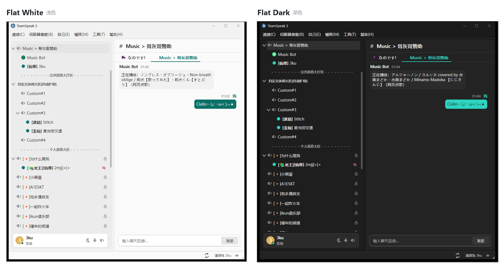

# Flat White · Flat Dark — TeamSpeak 3 主题

**简体中文** | [English](README.en.md)

## 风格

无渐变、无高光、无阴影。层次只靠 1px 发丝线、圆角和一种青绿强调色区分。
控件圆角 4px、面板 8px，正文 14px，字体统一 Microsoft YaHei UI，中英混排不跳行高。

- **Flat White**：底色 `#F2F2F2`，面板 `#FAFAFA`，正文 `#252525`，强调色 `#0B7068`。
- **Flat Dark**：底色 `#1B1B1B`，面板 `#232323`，正文 `#F2F2F2`，强调色 `#2DD4BF`。
  装上插件后，Windows 标题栏和窗口边框也会一起变暗。

两套主题配两套线性图标，另有一个插件：把界面重排成 Discord 那样的内容优先布局，
聊天改成气泡，带消息与戳一戳提醒、悬浮用户卡片，窗口可自由缩放。

## 下载

到[最新发布](https://github.com/mmk-1010/ts3-theme-flat-white/releases/latest)页面下载：

- **浅色**：[下载 Flat White](https://github.com/mmk-1010/ts3-theme-flat-white/releases/latest/download/Flat-White.zip)
- **深色**：[下载 Flat Dark](https://github.com/mmk-1010/ts3-theme-flat-white/releases/latest/download/Flat-Dark.zip)

两个包都含主题、图标和插件，插件是同一个，装哪个都一样。
音效是可选的，单独下载
[Flat White Sounds](https://github.com/mmk-1010/ts3-theme-flat-white/releases/download/v1.6/Flat-White-Sounds.ts3_soundpack) 或
[Flat Dark Sounds](https://github.com/mmk-1010/ts3-theme-flat-white/releases/download/v1.6/Flat-Dark-Sounds.ts3_soundpack)，内容相同。

## 安装

按顺序双击，每步装完重启客户端：

1. **主题**：双击 `.ts3_style`，重启后在 **工具 → 选项 → 设计 → 主题** 选 `flat_white` 或 `flat_dark`。
2. **图标包**：双击 `.ts3_iconpack`，重启后在 **设计 → 图标包** 选对应图标包。
3. **插件**：先完全退出 TS3，双击 `.ts3_plugin`，再启动后在 **工具 → 选项 → 插件** 确认已勾选。
4. **音效**（可选）：双击下载的 `.ts3_soundpack`，重启后在 **工具 → 选项 → 通知 → 音效包** 选择。

只装主题也能换肤。深色主题不装插件时只有客户区变暗，标题栏仍归系统绘制。

## 卸载

主题和图标包在 **选项 → 设计** 里切回默认；插件删
`%APPDATA%\TS3Client\plugins\flatwhite_ui_win64.dll`；音效删客户端目录 `sound\` 下对应的文件夹。

## 兼容性

TeamSpeak 3 3.6.2（Windows x64，Qt 5.15.2）实测通过。插件只有 win64 版本，
主题和图标包是纯资源，各平台通用但没在 macOS / Linux 上实测。
