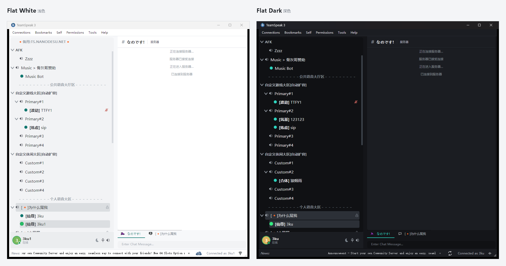

# Flat White · Flat Dark — TeamSpeak 3 主题包

**简体中文** | [English](README.en.md)

作者：**3ku-nanodesu**　版本：1.4

## 风格

浅色与深色两套主题，共用同一套扁平语言：无渐变、无高光、无阴影，层次只靠 1px 发丝线、
圆角和单一青绿强调色建立。控件圆角 6px、面板 8px，行高 22px，字体统一为
Microsoft YaHei UI 9pt，中英混排不跳行高。

- **Flat White（浅色）**：窗口底 `#F7F8FA`，面板纯白；正文 `#1F2328`，强调色 `#0F766E`。
- **Flat Dark（深色）**：窗口底 `#141519`，面板 `#1B1D22`；正文 `#E7E9EC`，强调色 `#2DD4BF`。
  装配套插件后，Windows 标题栏、窗口边框和对话框也会一起变暗，而不只是客户区。

配套两套线性图标、78 个合成音效，以及一个把界面重排为 Discord 式「内容优先」布局的插件。
所有素材自行绘制／合成，不含第三方图片或音频。

## 下载

到 [Releases](https://github.com/mmk-1010/ts3-theme-flat-white/releases) 页面任选一个压缩包：

| 压缩包 | 内容 |
| --- | --- |
| `Flat-White-1.4.zip` | 浅色主题 + 浅色图标 + 插件 + 音效 |
| `Flat-Dark-1.4.zip` | 深色主题 + 深色图标 + 插件 + 音效 |

两个包的插件功能和音效内容相同；深色包内的文件统一使用 Flat Dark 名称。插件负责
Discord 式布局、气泡聊天、消息与戳一戳提醒、悬浮用户卡片、深色标题栏和自由缩放窗口。
也可以单独下载主题、图标包、插件或音效包。

提醒音效会优先使用已经安装的 Flat White Sounds / Flat Dark Sounds 提示音，否则回退到
客户端默认音效包；面板里的离开 / 麦克风 / 耳机按钮不依赖音效包。

## 安装

解压后按顺序双击安装包，每步装完重启客户端：

1. **主题**：双击 `Flat White.ts3_style` 或 `Flat Dark.ts3_style`（两个都装也可以），
   重启后在 **工具 → 选项 → 设计 → 主题** 选 `flat_white`（浅色）或 `flat_dark`（深色）。
2. **图标包**：双击配套的 `.ts3_iconpack`，重启后在 **工具 → 选项 → 设计 → 图标包**
   选 *Flat White Icons*（浅色）或 *Flat Dark Icons*（深色）。
3. **插件**：先完全退出 TS3，双击对应包里的 `.ts3_plugin`（深色包为
   `Flat Dark UI.ts3_plugin`）；再次启动后到 **工具 → 选项 → 插件** 确认
   *Flat White UI* 已勾选（深浅两包共用同一个插件，不会重复加载）。
4. **音效**：双击 `.ts3_soundpack` 按提示安装（客户端装在 Program Files 下需要管理员权限），
   重启后在 **工具 → 选项 → 通知 → 音效包** 选 *Flat White Sounds*（浅色）或
   *Flat Dark Sounds*（深色）。

主题、图标包、插件和音效都可以不装，只装主题也能完成换肤。深色主题不装插件时只有客户区变暗，
窗口标题栏仍由系统绘制；装上插件后标题栏、边框和自绘控件会一起变深。

## 卸载

- 主题、图标包：**选项 → 设计** 里切回默认，或删掉客户端目录（主题）与
  `%APPDATA%\TS3Client\gfx`（图标包）里的对应条目。
- 插件：删除 `%APPDATA%\TS3Client\plugins\flatwhite_ui_win64.dll`。
- 音效：删除 `<客户端目录>\sound\flatwhite`，以及安装包生成的
  `sound\Flat White Sounds` / `sound\Flat Dark Sounds`。

## 兼容性

TeamSpeak 3 **3.6.2**（Windows x64，Qt 5.15.2）实测通过。插件仅提供 win64 版本；
主题与图标包为纯资源，各平台通用但未在 macOS / Linux 上实测。
