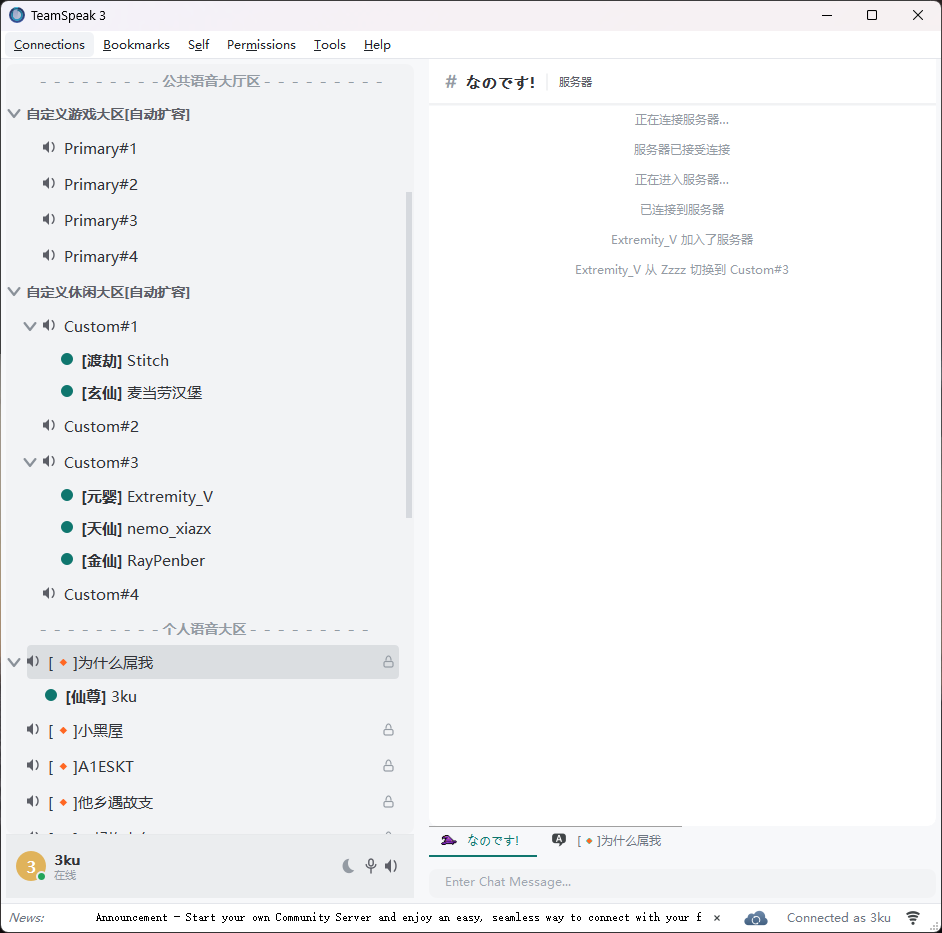

# Flat White — TeamSpeak 3 主题包

作者：**3ku-nanodesu**　版本：1.0

## 风格

扁平极简的纯白界面：无渐变、无高光、无阴影，层次只靠 1px 发丝线、圆角和单一青绿强调色
（`#0F766E`）建立。窗口底 `#F7F8FA`，面板纯白；正文近黑 `#1F2328`，次要信息 `#8A9199`。
控件圆角 6px、面板 8px，行高 22px，字体统一为 Microsoft YaHei UI 9pt，中英混排不跳行高。

配套约 190 个从零绘制的线性图标、78 个合成音效，以及一个把界面重排为 Discord 式
「内容优先」布局的插件。全部素材自行绘制／合成，不含第三方图片或音频。

## 下载

到 [Releases](https://github.com/mmk-1010/ts3-theme-flat-white/releases) 页面下载
**`Flat-White-1.0.zip`**：解压后四个安装包和安装说明都在同一个文件夹里，一次下齐，
不用逐个点。

也可以按需单独下载：

| 文件 | 作用 |
| --- | --- |
| `Flat-White.ts3_style` | 主题本体，换肤的基础，必装 |
| `Flat-White-Icons.ts3_iconpack` | 配套线性图标，建议一起装 |
| `Flat-White-UI.ts3_plugin` | 界面插件，Discord 式布局和气泡聊天，可选 |
| `Flat-White-Sounds.ts3_soundpack` | 78 个合成音效，可选 |
| `Flat-White-1.0.zip` | 以上四个包的整合包，含安装说明 |

## 安装

下载压缩包后解压，按顺序双击里面的四个安装包，每步装完重启客户端：

1. **主题**：双击 `.ts3_style`，重启后在 **工具 → 选项 → 设计 → 主题** 选 *Flat White*。
2. **图标包**：双击 `.ts3_iconpack`，重启后在 **工具 → 选项 → 设计 → 图标包** 选 *Flat White Icons*。
3. **插件**：先完全退出 TS3，双击 `.ts3_plugin` 按提示安装；再次启动后到
   **工具 → 选项 → 插件** 确认 *Flat White UI* 已勾选。
4. **音效**：双击 `.ts3_soundpack` 按提示安装（客户端装在 Program Files 下需要管理员权限），
   重启后在 **工具 → 选项 → 通知 → 音效包** 选 *Flat White Sounds*。

插件和音效包都是可选的，只装主题就能完成换肤。

## 卸载

- 主题、图标包：**选项 → 设计** 里切回默认，或删掉 `%APPDATA%\TS3Client\styles`、`gfx` 里对应条目。
- 插件：删除 `%APPDATA%\TS3Client\plugins\flatwhite_ui_win64.dll`。
- 音效：删除 `<客户端目录>\sound\flatwhite`。

## 兼容性

TeamSpeak 3 **3.6.2**（Windows x64，Qt 5.15.2）实测通过。插件仅提供 win64 版本；
主题与图标包为纯资源，各平台通用但未在 macOS / Linux 上实测。
